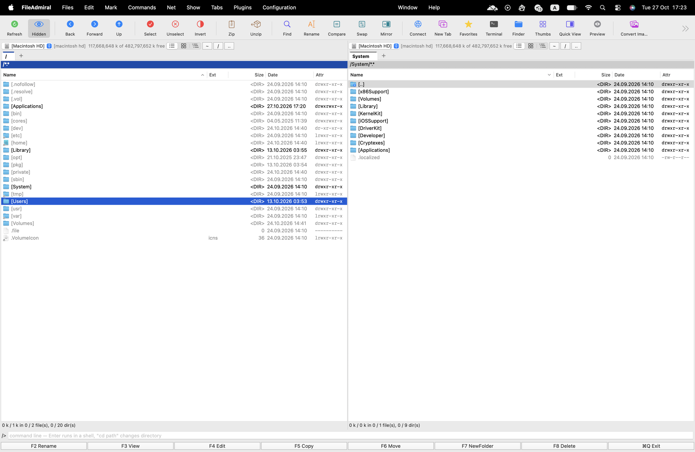
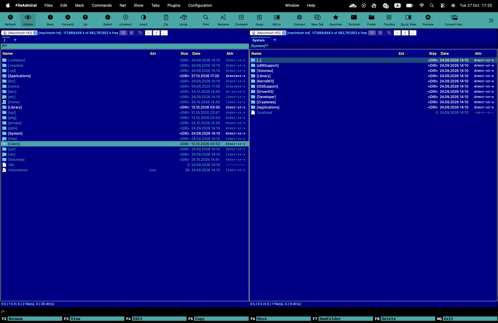

# FileAdmiral

One rank above Commander: a Total Commander–style dual-pane file manager for macOS. Native Swift + AppKit,
no dependencies, GPL-3.0.



Two panels, F-keys, marking with Space/Insert/+/-/*, a command line, tabs, FTP/SFTP in a panel,
archives you can walk into, Multi-Rename, Synchronize Folders, Find Duplicates, a disk-usage treemap,
script plugins — and a Norton Commander theme for the full 1990 experience.

Themes are supported too, if you are into the classic style:



## Status

Early. The core (copy / move / delete / rename / archives) is careful about your data — temp-file-and-rename
writes, `RENAME_EXCL` everywhere, undo through the Trash, a 125-check end-to-end self-test — but the app has
had few users. Keep backups, read the [changelog](CHANGELOG.md), and please
[report](../../issues) anything that surprises you, especially anything involving files going missing.

## Install

There are no notarized builds yet (that needs an Apple Developer account). Build it yourself:

```bash
git clone https://github.com/EugeneKite/file-admiral.git
cd file-admiral
./build.sh                                   # → build/FileAdmiral.app
cp -R build/FileAdmiral.app /Applications/   # optional
open build/FileAdmiral.app
```

Requirements: macOS 13 or newer and the Xcode Command Line Tools (`xcode-select --install`); full Xcode is
not needed. `build.sh` signs the app with a *local self-signed* certificate kept in its own keychain under
`~/Library/Application Support/FileAdmiral/signing`. That signature is stable across rebuilds, which is what
makes macOS remember the privacy permissions you grant; nothing is sent anywhere.

If you run a build someone else made, Gatekeeper will refuse it on first launch. Either
System Settings → Privacy & Security → *Open Anyway*, or `xattr -d com.apple.quarantine FileAdmiral.app`.

### Permissions

A file manager needs **Full Disk Access**. On first launch (and via Configuration → Permissions…, ⌥⌘,)
FileAdmiral shows a window that detects it live, opens the right System Settings pane, requests
Desktop / Documents / Downloads / iCloud Drive in one go, and offers a relaunch. macOS never lets an app grant
itself access, so one switch in System Settings is still yours to flip.

## Features

**Panels** — TC layout: volume bar with free space, tabs per panel, highlighted path header (click any folder
in it), Name / Ext / Size / Date / Attr columns, `[folders]` and `<DIR>`, TC status line, command line, F-key bar.
List, thumbnail (Quick Look) and folder-tree views; Quick View panel (⌃Q); quick search by typing.

**Marking** — Space / Insert / Shift+arrows / ⌘-click; `+` `-` `*` select by mask and invert; marked files in red;
Compare Directories (⌘⇧C); select by Finder tag.

**File operations** — F3 Lister (text with selectable encodings, hex, image, plugin viewers), F4 edit, F5 copy,
F6 move, F7 new folder, F8 trash (Shift+F8 permanent), F2 rename in place. Progress, cancel, APFS cloning,
overwrite prompts (Overwrite / Skip / All / Older), mask filters (`/dest/*.txt`), background queue, undo/redo.

**Archives** — pack to zip / tar.gz / tar.bz2 / tar.xz; unpack zip, tar, 7z, rar, iso… (via bsdtar); Enter on an
archive browses it. Unpacking goes through a staging folder, so existing files are never overwritten silently.

**Tools** — Find Files (masks, text inside files, optional Spotlight index), Multi-Rename Tool
(`[N] [E] [C] [P] [YMD]`, search/replace, regex, undo), Synchronize Folders, Compare by Content (side-by-side
diff), Find Duplicates (size → partial hash → full SHA-256, inode-aware), Disk Usage treemap, directory hotlist (⌘D),
folder history, Finder tags, Quick Look, Get Info, Open With, Share, Open Terminal here.

**Remote** — FTP / FTPS / SFTP connections in panel tabs (⌘K). SFTP uses the system OpenSSH (keys, ssh-agent,
`~/.ssh/config`); passwords live in the Keychain. Copy/move between local and remote; F4 edits a remote file and
uploads it on every save.

**Plugins** — a folder with a `plugin.json` and a script adds a menu/toolbar command or a Lister viewer.
Plugins → Install Sample Plugins gives six working examples; Plugins → How to Write a Plugin has the reference.
Scripts receive the selection as arguments and `FA_SOURCE_DIR`, `FA_TARGET_DIR`, `FA_CURSOR`, `FA_SELECTED`,
`FA_PLUGIN_DIR` in the environment.

**Appearance** — Classic, Norton Commander, Dark and Solarized themes (or follow the system), adjustable font
size, toolbar with or without labels.

Press **F1** in the app for the complete keyboard reference.

On a MacBook, function keys need `fn` unless "Use F1, F2, etc. keys as standard function keys" is on in
System Settings → Keyboard. Every F-key command is also in the menus and on the button bar.

## Self-test

```bash
swift build && FA_SELFTEST=/tmp/fileadmiral-selftest .build/debug/FileAdmiral
```

Drives the real UI in a scratch folder — panels, keyboard, copy/move/delete, undo, sync, duplicates, archives,
plugins, async listing — prints `PASS`/`FAIL` lines and exits. CI runs it on every push. FTP/SFTP tests need a
local sshd on port 2222 and `Tools/test_ftp_server.py` on port 2121 (`FA_TEST_SSH_KEY`, `FA_TEST_FTP_ROOT`,
`FA_KNOWN_HOSTS`).

## Contributing

See [CONTRIBUTING.md](CONTRIBUTING.md). The short version: run the self-test, add a check for what you change,
and never let a file be lost.

## License

GPL-3.0-or-later. See [LICENSE](LICENSE).

FileAdmiral is an independent project. Total Commander is a trademark of Christian Ghisler (Ghisler Software GmbH)
and Norton Commander a trademark of its respective owner; neither is affiliated with or endorses this app.
